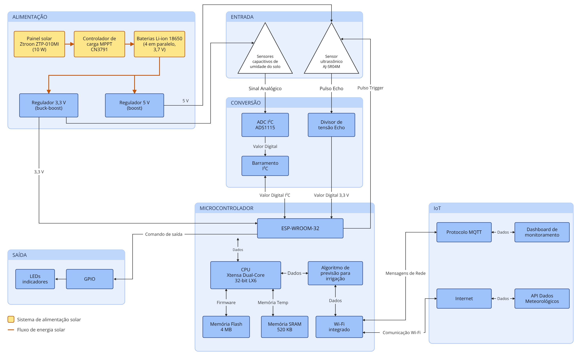

# Global Solution Soluções em Energias Renováveis e Sustentáveis (SERS)
# Diagnóstico do problema
## Espaço escolhido: Jardim ou horta comunitária
Escolhemos esse espaço porque conseguimos levantar uma solução energética sustentavel com base em uma arquitetura já elaborada para a entrega de **Arquitetura e Organização de Computadores** que consiste em sensores capacitivos que fazem uma leitura elétrica do solo, permitindo um calculo percentual da umidade volumétrica do plantio. 

## Público beneficiado:
O projeto beneficiaria membros de uma comunidade ou bairro com uma horta com irrigação inteligente e energéticamente eficiente e sustentavel.

## Condições de funcionamento da solução:
Para o funcionamento da solução precisamos de  
  1. Um microcontrolador ESP-WROOM-32
  2. Um sensor ultrassônico AJ-SR04M
  3. Sensor capacitivo de umidade do solo V1.2
  4. Painel solar Ztroon ZTP-010MI

Além disso, nós não consideramos perdas de fonte nem de conversão de tensão, e usamos um valor simulado de 4 horas de sol pleno por dia, com um cenário de 3 horas para uma análise conservadora.

## Benefícios esperados para a comunidade
Os moradores do local teriam acesso a horta comunitária onde podem realizar seu plantio e compartilhar recursos um com os outros de forma acessivel, já que a irrigação é adequada a cada tipo de planta e sustentável, já que a irrigação inteligente previne o desperdicio de água

# Análise do consumo energético
Estimamos o consumo do sistema com a fórmula E = (P × t) / 1000, considerando funcionamento contínuo de 24 h por dia, a corrente típica informada pelos fabricantes de cada componente e sem perdas de fonte, de conversão de tensão ou do sistema solar. O ESP-WROOM-32, o sensor capacitivo de umidade do solo V1.2 e o sensor ultrassônico AJ-SR04M somam 0,4665 W, o que dá cerca de 11,2 Wh por dia, ou 0,336 kWh por mês. Para a alimentação, dimensionamos um painel solar de 10 W (Ztroon ZTP-010MI), que gera de 30 a 40 Wh por dia com 3 a 4 horas de sol pleno (valor simulado), e 4 baterias 18650 em paralelo, que garantem 2 dias de autonomia sem sol.

Para os cálculos completos, as premissas e o dimensionamento solar, veja o arquivo original: [consumo_energetico.md](consumo_energetico.md).

# Comparação de alternativas
Comparamos duas alternativas para a mesma necessidade energética (0,336 kWh/mês, período de referência de 30 dias): energia solar e rede elétrica. Como hortas comunitárias geralmente não têm ponto de energia, a rede exigiria uma nova ligação, com custo de implantação estimado entre R$ 1.855,86 e R$ 3.055,86 e custo de disponibilidade de cerca de R$ 36,30 por mês. A energia solar tem custo inicial estimado de R$ 250,17 e praticamente nenhum custo de operação, além de funcionar sem tomada, manter o sistema ativo em quedas de energia e estar alinhada ao objetivo de sustentabilidade. Por isso, a solar foi a alternativa escolhida.

Para a tabela completa de critérios e a análise detalhada, veja o arquivo original: [comparacao.md](comparacao.md).

# Diagramação da solução
O diagrama de blocos mostra como os componentes se relacionam. A **alimentação** é solar: o painel carrega as baterias 18650 por meio do controlador MPPT, e as baterias alimentam os reguladores de 3,3 V e 5 V. Na **entrada**, os sensores capacitivos de umidade do solo (sinal analógico) e o sensor ultrassônico, que mede a reserva de água (pulso echo), fazem as medições. Na **conversão**, o ADC ADS1115 transforma o sinal analógico em digital pelo barramento I²C, e um divisor de tensão reduz o sinal echo de 5 V para 3,3 V, protegendo o **microcontrolador** ESP-WROOM-32. Nele, a SRAM guarda as últimas leituras, a Flash guarda o firmware e os parâmetros de calibragem, e o algoritmo usa as últimas 10 leituras para estimar a tendência da umidade e indicar se a plantação deve ser irrigada. Na **saída**, LEDs acionados por GPIO indicam a tendência da umidade (verde para subir, amarelo para estável e vermelho para cair) e se deve irrigar. Na **IoT**, o Wi-Fi envia os dados por MQTT ao dashboard de monitoramento e recebe de uma API meteorológica os dados que ajudam a prever a chuva e ajustar o algoritmo.

Para ver o diagrama em tamanho maior ou editá-lo, veja os arquivos originais: [diagrama_solucao_solar.png](diagrama_solucao_solar.png).

# Indicadores de eficiência e sustentabilidade
Os indicadores abaixo foram definidos a partir dos cálculos e das premissas da análise energética (consumo contínuo de 24 h, HSP simulado de 3 a 4 h e sem perdas), e comparam a solução solar com a alternativa da rede elétrica com nova ligação.

| Indicador | Valor | Unidade | Base de cálculo |
|---|:---:|:---:|---|
| Consumo de energia | 0,336 | kWh/mês | 11,196 Wh/dia × 30 dias |
| Economia energética estimada | 0,336 (100% do consumo) | kWh/mês ou % | Energia que deixa de ser consumida da rede, já que o sistema funciona com energia solar |
| Participação de energia renovável | 100 | % | Geração de 30 a 40 Wh/dia contra consumo de 11,196 Wh/dia (de 2,68 a 3,57 vezes o consumo) |
| Redução estimada de custos (operação) | 36,30 (cerca de 435 por ano) | R$/mês | Custo de disponibilidade da rede (30 kWh × R$ 1,21/kWh), desconsiderando os centavos do consumo real |
| Economia estimada na implantação | 1.605,69 a 2.805,69 | R$ (valor único) | Rede (R$ 1.855,86 a R$ 3.055,86) menos solar (R$ 250,17) |

Esses valores valem dentro das premissas adotadas. Para os cálculos e as fontes dos valores, veja [consumo_energetico.md](consumo_energetico.md) e [comparacao.md](comparacao.md).

fontes:  
- https://www.bitmaker.com.br/esp32-wifi-e-bluetooth-esp-wroom-32.html
- https://www.smartkits.com.br/sensor-capacitivo-de-umidade-do-solo?parceiro=9390
- https://www.fornell.com.br/produtos/sensor-ultrassonico-aj-sr04m-a-prova-de-agua/
- https://www.mercadolivre.com.br/painel-solar-10w-ztroon-monocristalino-ztp-010mi-azul-escuro-1000v-2472v/p/MLB74596095?pdp_filters=item_id%3AMLB7674420940&from=gshop&matt_tool=34755848&matt_word=&matt_source=google&matt_campaign_id=22090354298&matt_ad_group_id=173090578756&matt_match_type=&matt_network=g&matt_device=c&matt_creative=727882731306&matt_keyword=&matt_ad_position=&matt_ad_type=pla&matt_merchant_id=735128188&matt_product_id=MLB74596095-product&matt_product_partition_id=2494755919328&matt_target_id=pla-2494755919328&cq_src=google_ads&cq_cmp=22090354298&cq_net=g&cq_plt=gp&cq_med=pla
- https://m.magazineluiza.com.br/busca/modulo+lm2596/
- https://www.magazineluiza.com.br/busca/fonte+12v+2amp/
- https://monitordomercado.com.br/noticias/410146-quanto-custa-trocar-o-padrao-de-entrada-de-energia-para-suportar-os-novos-aparelhos-da-casa/
